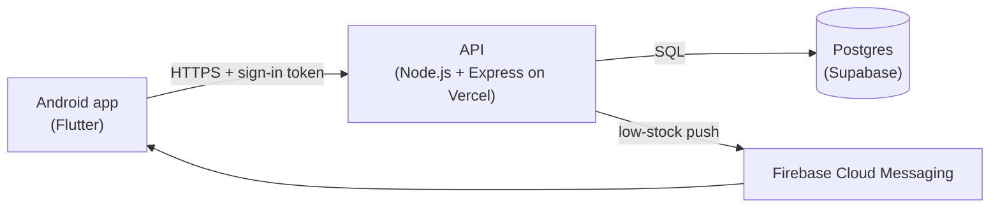
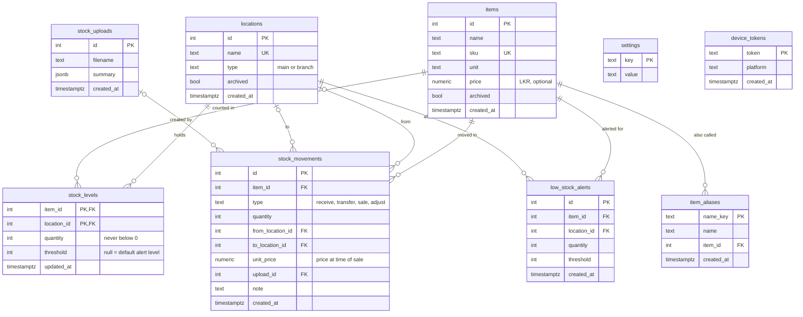

# shop-inventory

Stock management for a shop with a main store and several branches: see stock
at every location, add stock, move it to branches, record sales, and get a
phone alert when an item runs low.

> **Client project.** This app was designed and built for a client, a retail
> business with a main shop and branches. It is shared here as a portfolio
> piece. The code is public, but the client's data and the live server's
> settings and passwords are not part of this repository.

## What the app does

**Stock at every location**
- One main shop plus any number of branches. Add, rename or remove branches.
- See every item and its count at each place, with search and a "low stock" filter.
- Each item has a detail page with stock at every location, the total, and its
  recent history.

**Changing stock**
- Add new stock (to the main shop by default), move stock from one place to
  another, record a sale, or correct a count after a physical check.
- Stock never goes below zero. Every change is kept as a history record, so
  the counts always match the history.
- Move or sell a whole list of items at once by pasting a list copied from
  Excel or WhatsApp. The app learns other names an item goes by and matches
  them next time.

**Daily stock sheets and sales**
- Upload a shop's Excel (.xlsx) or CSV stock count from the phone. The app
  shows a preview of what will change (new items, items sold, items received,
  rows it can't use) before anything is saved.
- Counts that drop since the last sheet are recorded as sales.
- Sales screen: what sold on any day, per item and per place.
- End-of-day sales with prices in rupees, and a PDF sales report to share
  or save.

**Low-stock alerts**
- Each item has an alert level at each place. The default is 3 and can be
  changed, and any item can have its own level at a given place.
- When stock drops to the alert level, the app warns straight away and every
  signed-in phone gets a push notification (Firebase Cloud Messaging).
- A low-stock list with a one-tap refill from the main shop, and an alert history.

**Owner tools** (in Settings)
- Export stock or the item list to Excel or CSV.
- Reset counts to zero or delete items and branches, with a password check
  and an automatic backup first.
- Export and Reset are switched off on the server by default and can be
  turned on when needed.

**Security**
- The owner signs in with a password and gets a session token. The phone
  never connects to the database directly; everything goes through the API.
- Row level security is on for every table, so the database's own public API
  can't read or change anything.

## How it is built

- `backend/`: Node.js + Express API on Postgres. See [backend/README.md](backend/README.md).
- `app/`: Flutter Android app. See [app/README.md](app/README.md).
- Push notifications and building the APK: [docs/push-and-apk.md](docs/push-and-apk.md).

## Database

Stock is never edited directly. Each change is a row in `stock_movements`
(`receive`, `transfer`, `sale` or `adjust`), and the matching count in
`stock_levels` is updated in the same transaction.

`settings` holds app-wide values such as the default alert level, and
`device_tokens` holds the phones registered for push notifications. The
schema is built by the numbered files in
[backend/migrations](backend/migrations), which run automatically when the
server starts.
